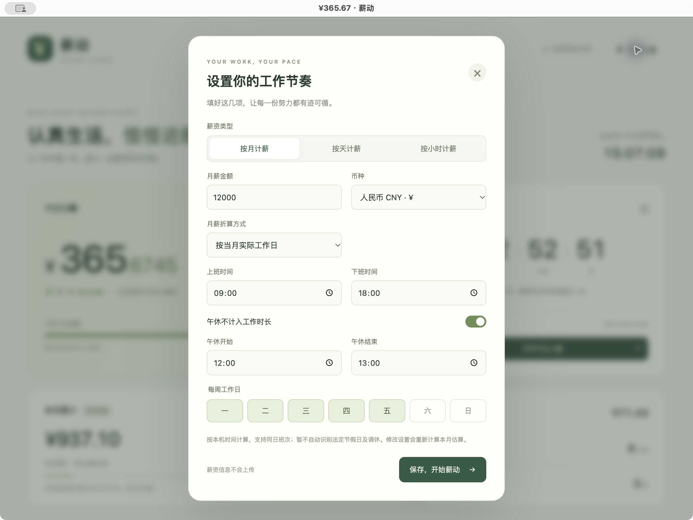

<div align="center">
  
  <h1>Payday Clock · 薪动</h1>
  <p><strong>Make every second count.</strong><br>Watch your earnings grow. Keep a little time for yourself, too.</p>
  <p><a href="README.md">简体中文</a> · <strong>English</strong></p>
  <p><a href="https://github.com/SamsurTee/payday-clock/releases/latest">Download</a> · <a href="#get-started-in-three-steps">Visual guide</a> · <a href="https://github.com/SamsurTee/payday-clock/issues">Feedback</a></p>
  <p>Windows · macOS · Browser &nbsp; / &nbsp; Works offline &nbsp; / &nbsp; MIT licensed</p>
</div>

---

Ever caught yourself wondering, **“How much have I earned so far today?”**

Payday Clock turns your pay and work schedule into a small, live dashboard: earnings today, income per second, and time until you clock out. Set it up once, then open it whenever you want a look. Earnings pause for lunch, and stop at the end of your shift.


<p align="center"><sub>Actual macOS app · Demo: CNY 12,000/month, 09:00–18:00, a one-hour unpaid lunch, Monday–Friday. All screenshots use example data.</sub></p>

**The app interface is currently in Simplified Chinese.** This English guide includes the exact Chinese button labels so you can follow along; it does not add an English interface to v1.0.0.

## A little motivation on your desktop

| What you want to know | What the app shows |
| --- | --- |
| What have I earned today? | Live earnings and income per second |
| How long until my time is my own? | A clock-out countdown and daily work progress |
| Can it fit my schedule? | Monthly, daily, or hourly pay; custom hours, lunch, and weekdays |
| Can I keep it in a corner? | A compact, always-on-top desktop window with shared settings |
| What might I earn this month? | Month-to-date and full-month estimates based on your schedule |
| Does anyone else see my salary? | No account, ads, telemetry, or uploads; settings stay on your device |

## Download and open

No Node.js installation or account required.

| Your computer | Download v1.0.0 | Start the app |
| --- | --- | --- |
| Windows x64 | [Portable EXE](https://github.com/SamsurTee/payday-clock/releases/download/v1.0.0/Payday-Clock-1.0.0-windows-x64-portable.exe) | Double-click the downloaded file |
| Mac · Apple Silicon (M series) | [App ZIP](https://github.com/SamsurTee/payday-clock/releases/download/v1.0.0/Payday-Clock-1.0.0-mac-arm64.zip) | Unzip, then drag `薪动.app` into Applications |
| Mac · Intel | [App ZIP](https://github.com/SamsurTee/payday-clock/releases/download/v1.0.0/Payday-Clock-1.0.0-mac-x64.zip) | Unzip, then drag `薪动.app` into Applications |

[Latest release and SHA-256 checksums →](https://github.com/SamsurTee/payday-clock/releases/latest)

<details>
<summary>Seeing an unknown-publisher or unverified-app message?</summary>

This first release has no commercial code-signing certificate or Apple notarization. The macOS packages use ad-hoc signing. Check the repository source and the release's SHA-256 checksums, then use your system's security settings to decide whether to allow the app. You do not need to disable system-wide security protection.

The Apple Silicon app has been checked on macOS for launch, saving settings, live earnings, and the focus window. Both Mac packages passed signature-integrity checks. The Windows EXE was cross-built on macOS and has not yet been interactively tested on Windows hardware.

</details>

## Get started in three steps

### 01 · Set your working rhythm

The setup dialog appears on first launch. Open **薪资设置** (Pay settings) in the top-right corner to change it later.

1. Select monthly, daily, or hourly pay; enter the amount and currency. Monthly pay can be divided by scheduled workdays in the current month or a fixed number of paid days.
2. Enter your start and finish times. Enable the lunch toggle and enter its start/end times to exclude an unpaid break.
3. Select your working weekdays, then click **保存，开始薪动 →** (Save and start).



| Label in the app | Meaning |
| --- | --- |
| 按月计薪 / 按天计薪 / 按小时计薪 | Monthly / daily / hourly pay |
| 月薪金额 / 币种 | Monthly pay amount / currency |
| 上班时间 / 下班时间 | Shift start / shift end |
| 午休不计入工作时长 | Exclude lunch from paid time |
| 每周工作日 · 一 二 三 四 五 六 日 | Working weekdays · Mon Tue Wed Thu Fri Sat Sun |

### 02 · See the day's progress

After saving, the dashboard updates automatically. Use the main screenshot above as a guide:

| Where to look | What it means |
| --- | --- |
| Top-left: 今日已赚 | Earnings for elapsed paid working time today, shown to four decimal places |
| Top-right: 距离下班还有 | Wall-clock time until your shift ends, including remaining lunch time; before work, it counts down to your start time |
| Progress bar below earnings | Completed paid working time as a proportion of the day's total |
| Bottom-left: 本月累计 | Estimated earnings from completed scheduled days this month, plus today's earnings |

Earnings pause during lunch, stop at the end of the shift, and stay at zero on days off. Close and reopen the app whenever you like: it recalculates from the current time.

### 03 · Keep it in a corner

Click **打开专注小窗** (Open focus window) below the countdown for a compact view of earnings, progress, and remaining time. In the desktop app, this window stays on top by default.

<p align="center"></p>

- **Toggle always-on-top:** `⌘ + Shift + T` on macOS or `Ctrl + Shift + T` on Windows, for the currently focused window.
- **Change settings:** the focus window also has a **薪资设置** button in its top-right corner.
- **Close the small window:** use its close button; the main window remains available. Press `Alt` on Windows to reveal the menu bar.

## What does each second represent?

```text
Daily pay = monthly pay ÷ scheduled workdays this month (or a fixed divisor)
Pay per second = daily pay ÷ paid working seconds per day
Earned today = elapsed paid working seconds today × pay per second
```

**For example:** CNY 12,000/month, 21 working days, and 8 paid hours per day gives approximately CNY 571.43/day, CNY 71.43/hour, and CNY 0.0198/second. After four paid hours, earnings are about CNY 285.71. Calculations retain full precision; displayed figures are rounded.

Daily-pay mode uses your entered daily amount directly. In hourly-pay mode, pay per second is your hourly rate divided by 3,600.

<details>
<summary>Estimates and scheduling assumptions</summary>

- Shifts must start and end on the same day. Lunch is unpaid, earnings are zero on days off, and accumulation stops at shift end.
- Month-to-date estimates assume all earlier scheduled days this month were fully worked. Changing settings recalculates those estimates. This is not an attendance record or a record of actual payments.
- With a fixed paid-day divisor, the full-month estimate may differ from your entered monthly salary.
- Public holidays, make-up workdays, leave, overtime, taxes, and exchange rates are not handled automatically. CNY, USD, and HKD change the displayed currency; they do not convert amounts.
- Calculations use your device's clock. Changing its date, time, or time zone changes the result.

</details>

## Where does the data go?

Settings stay in local `localStorage`; they are not uploaded. The desktop main and focus windows share settings. Desktop, browser, different browsers, and different devices do not sync automatically.

| Platform | Desktop data directory |
| --- | --- |
| macOS | `~/Library/Application Support/PaydayClock` |
| Windows | `%APPDATA%/PaydayClock` |

Clearing app data or browser site data removes your configuration. When switching between desktop and browser versions, enter your settings again.

## Browser use and development

<details>
<summary>Prefer to use your browser?</summary>

Download the source and open `index.html`. Some browsers restrict storage for local files; alternatively, run this in the project directory:

```sh
python3 -m http.server 8765 --bind 127.0.0.1
```

Visit <http://127.0.0.1:8765>. The web version uses plain HTML, CSS, and JavaScript and does not require the project's npm dependencies. Its focus window is a normal browser popup, with no guaranteed always-on-top behavior.

</details>

<details>
<summary>Develop, test, and package the desktop app</summary>

With a supported Node.js LTS version installed:

```sh
git clone https://github.com/SamsurTee/payday-clock.git
cd payday-clock
npm ci
npm test
npm start
```

| Build target | Command |
| --- | --- |
| macOS Apple Silicon + Intel (run on a Mac) | `npm run dist:mac` |
| Windows portable EXE (run on Windows) | `npm run dist:win` |
| Cross-build the Windows EXE on a Mac | `npm run dist:win:cross` |

Output is written to `dist/`. Cross-building skips Windows PE icon and version-resource editing. If Finder metadata in an iCloud/synced folder causes signing errors, append `-- -c.directories.output=/private/tmp/payday-clock-dist` to the build command to use a non-synced output directory.

Dependencies are pinned in `package-lock.json`; local builds do not require GitHub credentials or signing keys. For future signing/notarization, use secure environment variables or certificate storage, and never commit private keys.

| File | Purpose |
| --- | --- |
| `index.html` / `styles.css` | Dashboard, responsive layout, and settings form |
| `calculator.js` | Standalone pay and schedule calculations |
| `app.js` | Live display, local storage, and focus-window interactions |
| `desktop/` | Electron windows, always-on-top behavior, single-instance handling, and navigation restrictions |
| `tests/` | Calculation boundaries and local-page access rules |
| `docs/images/` | Actual app screenshots captured with example data |

All 10 current automated tests pass, covering lunch, shift boundaries, weekends, month changes, pay types, input validation, and desktop navigation restrictions.

</details>

## Make it a little nicer to use

[Open an issue](https://github.com/SamsurTee/payday-clock/issues) with your system, app version, and steps to reproduce a problem, or send a pull request. Hide real salary figures before sharing screenshots.

Released under the [MIT License](LICENSE): use, modify, distribute, and use commercially while retaining the copyright and license notice. Independently implemented; no source code or assets were taken from the reference app. Dependencies such as Electron retain their own licenses.

---

<p align="center">A little progress, one second at a time.<br><sub>Work well. Rest well, too.</sub></p>
